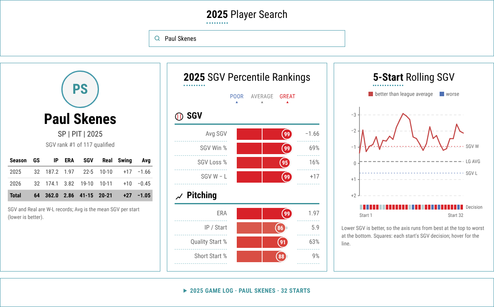

# Starter Game Value (SGV)

**A pitching record built on the pitching alone: every start is an SGV win, loss or no-decision.**

A starting pitcher's win-loss record depends on things they don't control, mostly their team's hitting and bullpen. SGV asks a simpler question: **did this start give the team a realistic chance to win?** It assumes a league-average offense and bullpen and adjusts for the ballpark, so every starter ends the season with an SGV record (for example 22-5) to compare with the real one.

**Live leaderboards, updated every day during the season:**
- MLB: https://luca-pfi.github.io/MLB-STARTER-GAME-VALUE/
- Minor leagues: https://luca-pfi.github.io/MLB-STARTER-GAME-VALUE/sgv_milb.html



---

## How it works

```
SGV = (ER + Bullpen RA9 × (9 − IP) / 9) − (Runs per team game × Park factor)
```

| Term | Meaning |
|---|---|
| **ER** | Earned runs allowed by the starter |
| **IP** | Innings pitched by the starter |
| **Bullpen RA9** | League-average bullpen runs allowed per 9 innings that season |
| **Runs per team game** | League-average runs scored per team per game that season |
| **Park factor** | How much the ballpark helps or hurts scoring (from FanGraphs, e.g. Coors Field 1.12) |

The first part is the runs the team should allow: the starter's own runs, plus what an average bullpen would give up in the innings left. The second part is what an average lineup would score in that park. **A negative SGV is good**: the team should outscore its opponent.

Each start then gets a decision, based on how often teams actually win at that SGV:

| SGV (2025–2026) | Decision | Teams won |
|---|---|---|
| below −1.05 | **SGV W** | 73% |
| −1.05 to +0.60 | **SGV ND** (a coin flip) | 50% |
| above +0.60 | **SGV L** | 23% |

The cut-offs are set once per season from earlier seasons' data and don't move during the year.

**What SGV removes from W-L:** run support and bullpen luck, and it adjusts for the ballpark. **What it doesn't:** schedule strength and the quality of the defense. It doesn't replace ERA, FIP or WAR; it answers a different question.

Example: in 2025, **Paul Skenes** went 10-10 in real life but **22-5** by SGV.

---

## Minor leagues

The MiLB page covers **Triple-A, Double-A, High-A and Single-A** with the same record, adjusted for the minors:

- **League averages per league**, because some leagues score far more than others (e.g. the Pacific Coast League vs the International League).
- **7-inning doubleheaders** are scored over 7 innings, not 9.
- **Park factors are computed from the games**, since FanGraphs doesn't publish minor-league ones.

---

## On the website

- **SGV Leaders:** the best SGV records of the season; expand to every qualified starter and sort by any column.
- **Hard Luck:** pitchers whose SGV record is much better than their real one.
- **Fortunate:** pitchers whose real record is better than their pitching earned.
- **Player search:** any starter's SGV record, percentile rankings, start-by-start chart and game log.

---

## Run it yourself

Requires Python 3.9+. The data comes from the free MLB Stats API, no key needed.

```bash
pip install -r requirements.txt
```

```bash
python sgv.py
```

This downloads every 2025–2026 start (the first run takes a few minutes, later runs only fetch new games) and writes:

- `sgv_report.html` and `sgv_records.xlsx`: the MLB leaderboards and every start
- `sgv_milb.html` and `sgv_milb_records.xlsx`: the same for the minor leagues

| Option | Effect |
|---|---|
| `--seasons 2025 2026 2027` | Seasons to score (default 2025 and 2026) |
| `--no-milb` | Skip the minor leagues |
| `--no-open` | Don't open the page in the browser |

To check everything works without downloading anything: `python test_sgv.py`.

---

## Keeping it up to date

A GitHub workflow (`.github/workflows/sgv-daily.yml`) updates the data and the website **every morning from March to October**. Each season:

- **In March,** check `park_factors.csv`: new-season values are copied from the year before. Update them from the [FanGraphs Guts page](https://www.fangraphs.com/guts.aspx?type=pf) when published.
- **Over the off-season,** GitHub pauses scheduled workflows after 60 days without activity, so the workflow re-enables itself on 15 November and 10 January. If the update has stopped anyway, open the **Actions** tab and click **Enable workflow**.

---

## Data sources

- Games, box scores and pitching lines: [MLB Stats API](https://statsapi.mlb.com)
- MLB park factors: [FanGraphs](https://www.fangraphs.com/guts.aspx?type=pf)

## Main files

| File | What it is |
|---|---|
| `sgv.py` | The main script: downloads the data and calculates SGV |
| `milb.py` | The minor-league version |
| `sgv_report.py` | Builds the website pages |
| `park_factors.csv` | MLB park factors per season |
| `sgv_records.xlsx`, `sgv_milb_records.xlsx` | Every start with its SGV, MLB and minor leagues |
